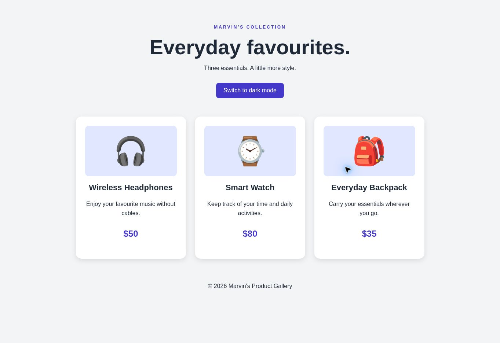

# Product Gallery

A three-card product gallery built with HTML, CSS and JavaScript.

[Live demo](https://marvericklnk.github.io/product-gallery-checkpoint/)

## Features

- Three product cards with descriptions and prices.
- Light and dark mode.
- Hover effects and fade-in animations.

## Run locally

Download the code and open `index.html` in your browser, or open the folder in VS Code and use Live Server.
